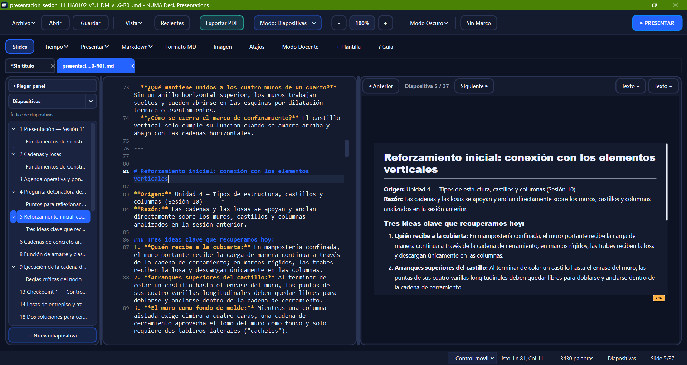
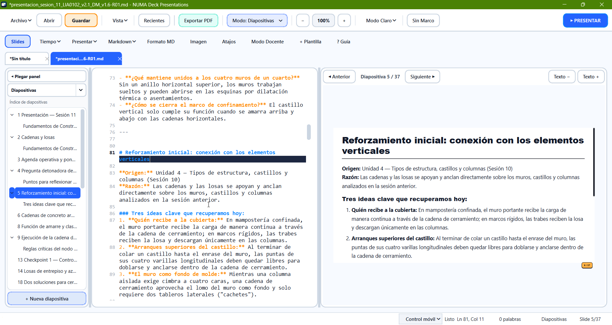
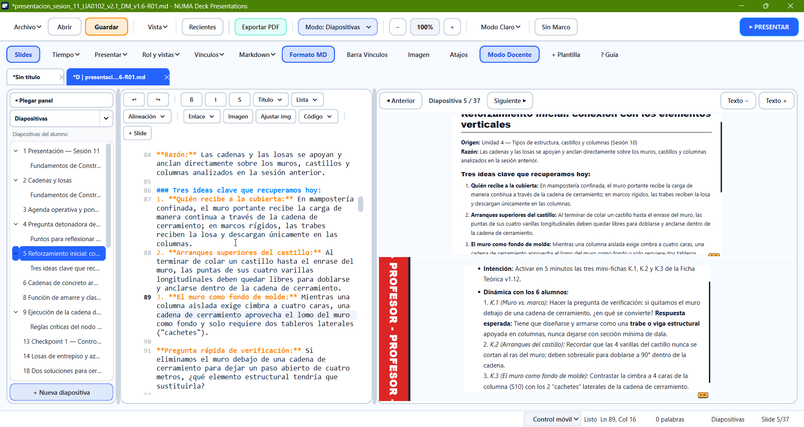
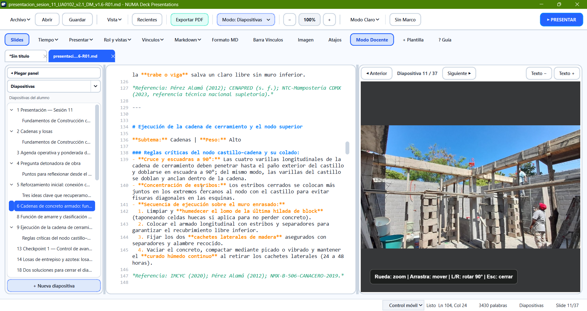
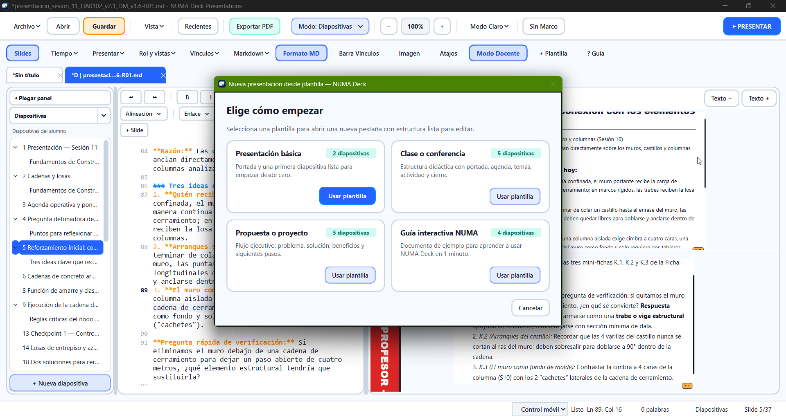
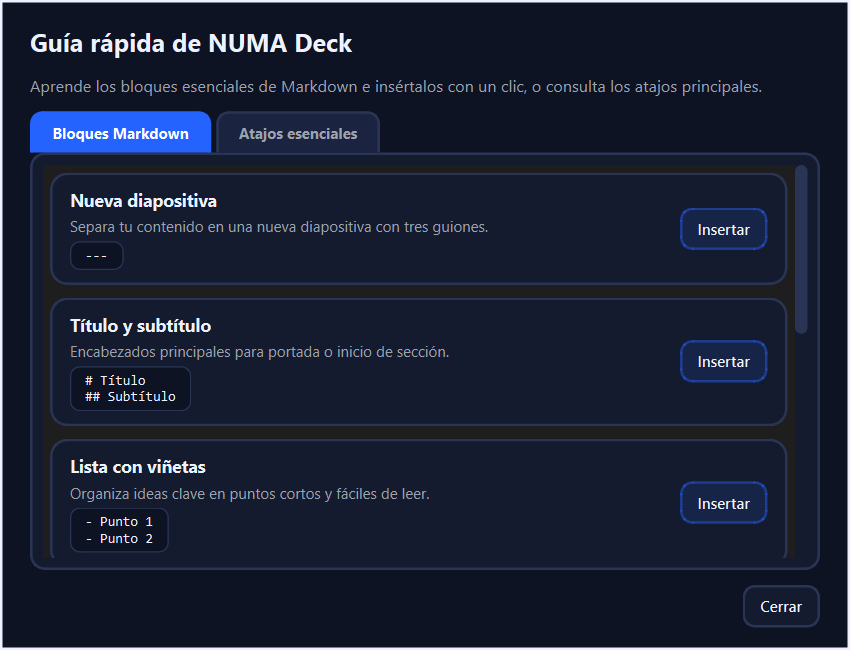

<div align="center">


# NUMA Deck Presentations

**Editor y presentador abierto de diapositivas en Markdown para escritorio —pensado para docentes, ponentes y equipos técnicos— que transforma texto plano en presentaciones en vivo, documentos continuos y PDFs listos para compartir.**


<br />


<br />

[¿Qué es?](#qué-es-numa-deck-presentations) •
[¿Para qué fue pensado?](#para-qué-fue-pensado) •
[¿Cómo funciona?](#qué-hace-y-cómo-funciona) •
[Formatos](#formatos-de-archivo-y-contenido-soportado) •
[Onboarding](#onboarding-para-usuarios-nuevos) •
[Inicio Rápido](#requisitos-e-instalación) •
[Atajos](#atajos-esenciales) •
[Estructura](#estructura-del-proyecto)

</div>

---

## ¿Qué es NUMA Deck Presentations?

**NUMA Deck Presentations** es una aplicación de escritorio construida en Python con **PySide6** y **Qt WebEngine** que convierte archivos de texto plano en formato **Markdown** en presentaciones listas para proyectar, documentos de lectura continua u hojas listas para imprimir y exportar a PDF.

A diferencia de los editores de diapositivas tradicionales donde se invierte gran parte del tiempo alineando cuadros de texto y ajustando estilos manualmente, NUMA Deck separa el contenido del diseño: escribes en Markdown a la izquierda y ves el resultado formateado en tiempo real a la derecha, bajo una estética moderna, limpia y consistente en modo claro y oscuro.


*Espacio de trabajo en Modo Oscuro: índice de diapositivas plegable a la izquierda, editor Markdown con resaltado de sintaxis al centro y vista previa en tiempo real a la derecha.*

---

## ¿Para qué fue pensado?

El proyecto nació para resolver una necesidad muy concreta en docencia, charlas técnicas y documentación de proyectos: **mantener el contenido en un único archivo de texto ligero, portable y fácil de versionar**, sin sacrificar una experiencia de presentación profesional frente a una audiencia.

- **Docentes y ponentes:** permite preparar una clase en Markdown y, si se activa el *Modo Docente*, proyectar una presentación limpia al alumnado en una segunda pantalla mientras se consulta un guion sincronizado del profesor en la pantalla principal.
- **Estudiantes, ingenieros y creadores técnicos:** soporta de forma nativa ecuaciones matemáticas con **KaTeX**, bloques de código con resaltado de sintaxis, tablas extensas con paginación automática e imágenes vectoriales `.svg`.
- **Usuarios sin experiencia en Markdown:** incluye un índice visual de diapositivas, plantillas listas para empezar, una barra de formato accesible y una *Guía rápida (`F1`)* que inserta bloques completos con un solo clic.
- **Un solo archivo, múltiples salidas:** el mismo documento `.md` puede proyectarse en pantalla completa `16:9`, leerse como documento continuo o imprimirse en formato Carta, Oficio, A4 o A3 con encabezados y numeración de páginas.

---

## ¿Qué hace y cómo funciona?

### Edición y vista previa en tiempo real (Modo Claro y Oscuro)

El espacio de trabajo se divide en tres áreas redimensionables y plegables: un **panel lateral** con el índice navegable de diapositivas (y explorador de archivos opcional), un **editor Markdown** con resaltado de sintaxis, numeración de líneas y pestañas múltiples, y una **vista previa instantánea** que se sincroniza con la posición del cursor. El tema puede alternarse en cualquier momento entre Automático (Windows), Claro y Oscuro.


*Modo Claro: alta legibilidad para aulas o salas iluminadas, manteniendo la misma jerarquía visual y sincronización instantánea entre editor y vista previa.*

### Tres modos de visualización

- **Diapositivas:** divide el documento en slides independientes cada vez que escribes tres guiones (`---`) en una línea vacía. Ideal para proyectar en pantalla completa (`F11`) o con puntero inalámbrico.
- **Continuo:** muestra todo el contenido en flujo vertical tipo artículo o apunte digital con desplazamiento suave.
- **Hoja impresa:** pagina el documento en tamaño Carta, Oficio, A4 o A3 (vertical u horizontal), permitiendo ajustar encabezados, pies de página y escala tipográfica antes de exportar a PDF.

### Modo Docente, vista dual y herramientas en vivo

- **Pantalla completa (`F11` / `F5`):** proyección limpia con soporte para modo *Sin Marco*, zoom interactivo, apertura de imágenes a pantalla completa y navegación por teclado o presentador inalámbrico.
- **Reloj, cronómetro y temporizador:** indicador configurable en cualquiera de las cuatro esquinas de la diapositiva, visible para el ponente, la audiencia o ambos.
- **Modo Docente (opcional):** divulgación progresiva para mantener la interfaz simple por defecto y habilitar guion de profesor, barra de formato Markdown, vista previa dual (alumno arriba y notas del profesor abajo con marca roja identificadora) y vinculación slide-a-slide solo cuando se necesita.
- **Control móvil:** emparejamiento con *NUMA Deck Android-Link* mediante código QR en red local (WebSocket con token de sesión) o conexiones directas por Bluetooth y Wi-Fi Direct.
- **Resiliencia y autoguardado:** respaldo automático atómico en segundo plano con recuperación por documento ante cierres inesperados.


*Modo Docente y barra de formato Markdown: vista previa dual con la diapositiva del alumno arriba, el guion sincronizado del profesor abajo (identificado con la banda lateral roja) y herramientas de formato integradas sobre el editor.*

---

## Formatos de archivo y contenido soportado

NUMA Deck trabaja directamente sobre archivos abiertos y estándar para que tu contenido nunca quede atrapado en un formato propietario:

| Categoría | Formatos / Sintaxis | Detalles de soporte |
| --- | --- | --- |
| **Documentos de entrada y guardado** | `.md`, `.markdown`, `.txt` | Texto plano en **UTF-8**. Compatible con cualquier editor externo (VS Code, Obsidian, Notepad) y con control de versiones Git. |
| **Imágenes (arrastrar y soltar)** | `.png`, `.jpg`, `.jpeg`, `.webp`, `.gif`, `.svg` | Al arrastrar una imagen al editor se puede copiar automáticamente a `assets/` junto al documento. Soporta ancho porcentual, alineación, rotación, escala de grises, marcos y reparación automática de rutas rotas. |
| **Exportación** | `.pdf` | Vista previa previa a la exportación en 3 perfiles: *Presentación 16:9 horizontal*, *Documento carta vertical* y *Hoja impresa* (Carta, Oficio, A4, A3). Permite omitir automáticamente slides con enlaces a archivos locales. |
| **Matemáticas y código** | LaTeX (`KaTeX`) y bloques ```` ```lenguaje ```` | Renderizado offline de ecuaciones en línea (`$...$`) y en bloque (`$$...$$`) mediante KaTeX empaquetado localmente; resaltado de sintaxis con `Pygments`. |
| **Enlaces e interactividad** | Web (`http/https`), archivos locales, enlaces entre slides | Permite saltar entre diapositivas internas mediante IDs persistentes, abrir archivos locales desde la presentación y abrir enlaces web con el navegador del sistema. |


*Soporte y visor interactivo de imágenes: carga fotografías, diagramas o gráficos `.png`, `.jpg`, `.webp` y `.svg` directamente en tus diapositivas, y ábrelos en cualquier momento con zoom por rueda, desplazamiento por arrastre y rotación de 90° (`L` / `R`).*

---

## Onboarding para usuarios nuevos

Para que cualquier persona pueda empezar a crear presentaciones sin memorizar sintaxis de entrada, la interfaz incorpora un selector de plantillas listas y una guía rápida interactiva accesible con `F1`:


*Selector de plantillas (`Ctrl + Shift + N`): elige entre presentación básica, clase o conferencia, propuesta o guía interactiva para comenzar con estructura lista.*


*Guía rápida interactiva (`F1`): consulta la sintaxis esencial e inserta bloques completos (tablas, listas, citas, fórmulas KaTeX o código) con un clic.*

---

## Requisitos e instalación

Actualmente está orientado a **Windows 10 / 11** con **Python 3.11 o superior**. Todas las dependencias se instalan dentro de un entorno virtual local:

```powershell
git clone https://github.com/Czbm/numa-deck-presentations.git
cd numa-deck-presentations

python -m venv .venv
.\.venv\Scripts\Activate.ps1
pip install -r requirements.txt

python main.py
```

### Ejemplo mínimo de documento

Guarda este texto como `demo.md` o pégalo en una pestaña nueva y pulsa **▶ PRESENTAR** (`F11`):

```markdown
# Mi primera presentación

Subtítulo o nombre del expositor

---

## Ideas clave

- Escribe en Markdown estándar sin preocuparte por maquetar cajas
- Arrastra imágenes `.png`, `.jpg` o `.svg` directamente al editor
- Usa fórmulas como $E = mc^2$ o tablas comparativas
```

---

## Atajos esenciales

| Atajo | Acción |
| --- | --- |
| `F11` / `F5` | Iniciar o salir de la presentación en pantalla completa |
| `←` / `→` / `Espacio` | Navegar entre diapositivas durante la presentación |
| `Esc` | Salir del modo presentación |
| `Ctrl + Shift + N` | Crear nueva presentación desde plantilla |
| `F1` | Abrir Guía rápida de Markdown y atajos |
| `Ctrl + Shift + M` | Mostrar u ocultar la barra de formato Markdown |
| `Ctrl + E` | Abrir vista previa y exportar a PDF |
| `Ctrl + 0` | Restablecer zoom al 100% |

---

## Estructura del proyecto

- `main.py` — Ventana principal, pestañas, navegación, exportación PDF y coordinación del modo presentación.
- `editor.py` — Editor Markdown con resaltado de sintaxis, numeración de líneas y drag & drop de imágenes.
- `preview.py` — Vista de renderizado HTML/KaTeX sobre `QWebEngineView` para los modos Diapositivas, Continuo y Hoja impresa.
- `styles.py` — Tokens visuales del sistema NUMA (claro/oscuro), hojas de estilo QSS y plantillas HTML.
- `parser.py` — Conversión Markdown, paginación de tablas, enlaces internos entre slides y validación de recursos locales.
- `onboarding_dialogs.py` — Selector de plantillas y Guía rápida interactiva de Markdown.
- `mobile_link.py`, `direct_connections.py` y `direct_connections_dialog.py` — Receptor WebSocket autenticado, código QR y conexiones directas Bluetooth / Wi-Fi Direct.
- `recovery_service.py` — Autoguardado atómico y recuperación tras cierres inesperados.
- `assets/` — Recursos locales de KaTeX e iconos vectoriales y de aplicación (`numa_deck.ico`).

---

## Contribuir y licencia

Las ideas, reportes de errores y mejoras son bienvenidos a través de *Issues* y *Pull Requests*.

Este proyecto utiliza un esquema de licenciamiento abierto con **copyleft (compartir igual)** para garantizar que el proyecto y sus derivados permanezcan abiertos para la comunidad:

- **Código fuente (`*.py`, pruebas y configuración):** licenciado bajo **GNU General Public License v3.0 (GPLv3)**. Cualquier modificación o versión derivada que se distribuya debe mantenerse libre y bajo la misma licencia. Consulta [LICENSE](LICENSE).
- **Documentación, guías, plantillas y recursos visuales propios (`README.md`, `docs/`, `assets/icons/`, `assets/esquemas/`):** licenciados bajo **Creative Commons Attribution-ShareAlike 4.0 International (CC BY-SA 4.0)**. Consulta [LICENSE-DOCS](LICENSE-DOCS).
- **Componentes de terceros:** conservan sus licencias originales (`assets/katex/` bajo MIT; `PySide6` bajo LGPLv3).
